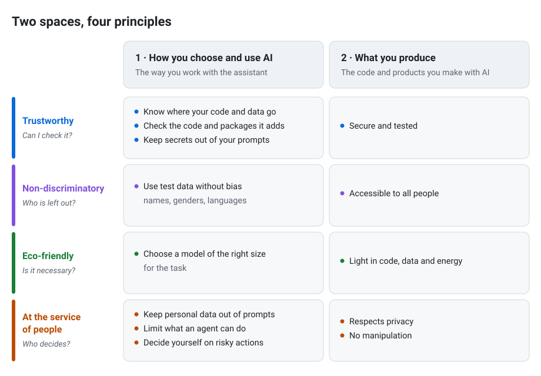

# responsible-ai-coding

Tools for developers who code with AI and want to do it in a responsible way.

The tools cover two spaces, and four principles apply to both.

  

## 1. How you choose and use AI

Choose your AI coding assistant, and use it, in a responsible way:

- know where your code and data go, and choose a provider that you can trust;
- choose a model of the right size for the task;
- keep secrets and personal data out of your prompts;
- limit what an agent can do: commands, files, network access;
- check what the assistant writes before you accept it, including the packages it adds;
- use test data without bias: names, genders, languages;
- keep the final decision for risky actions.

## 2. What you produce

Make sure that the code and products you make with AI are responsible:

- secure and tested;
- accessible to all people;
- light in code, data and energy;
- respectful of privacy, with no manipulation.

## Principles

Both spaces follow the same four principles:

- **Trustworthy**
- **Non-discriminatory**
- **Eco-friendly**
- **At the service of people**

> No tool is published yet.

## Licence

[MIT](LICENSE)
