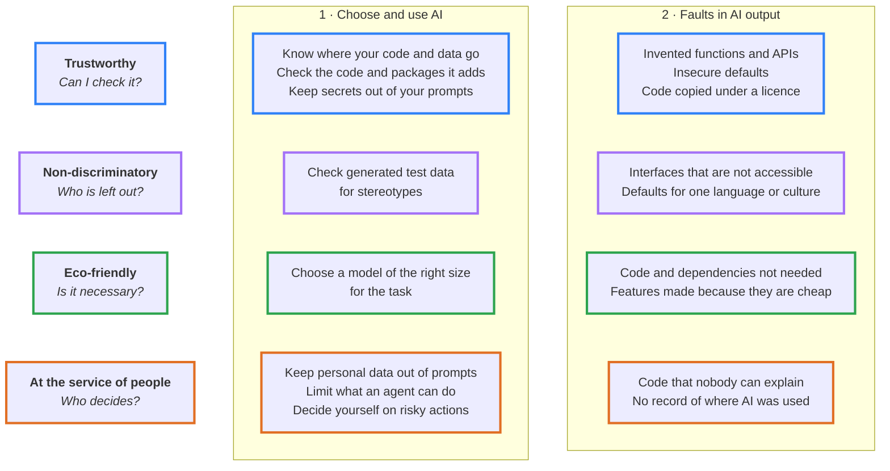

# responsible-ai-coding

Tools for developers who code with AI and want to do it in a responsible way.

The tools cover two spaces, and four principles apply to both.

## 1. How you choose and use AI

Choose your AI coding assistant, and use it, in a responsible way:

- know where your code and data go, and choose a provider that you can trust;
- choose a model of the right size for the task;
- keep secrets and personal data out of your prompts;
- limit what an agent can do: commands, files, network access;
- check what the assistant writes before you accept it, including the packages it adds;
- check that generated examples and test data have no stereotypes;
- keep the final decision for risky actions.

## 2. What AI changes in your output

Code made with AI has its own typical faults. Find them and correct them:

- invented functions, insecure defaults, code copied under a licence;
- interfaces that are not accessible, and defaults that assume one language or one culture;
- code and dependencies that the task does not need, and features made only because AI makes them cheap;
- code that nobody on the team can explain, and no record of where AI was used.

## Principles

Both spaces follow the same four principles:

- **Trustworthy**
- **Non-discriminatory**
- **Eco-friendly**
- **At the service of people**

> No tool is published yet.

## Licence

[MIT](LICENSE)
